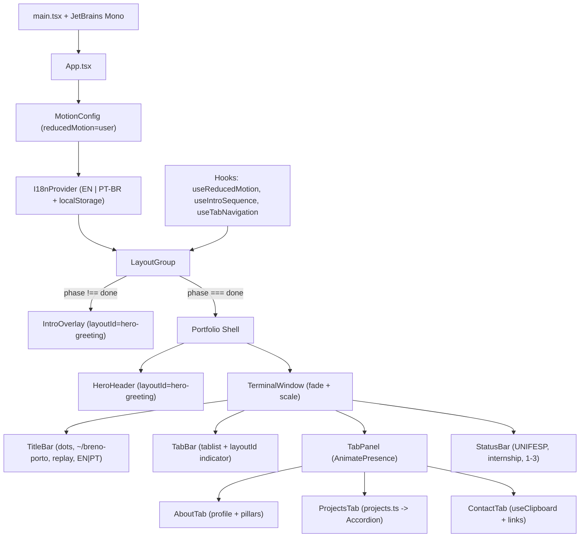
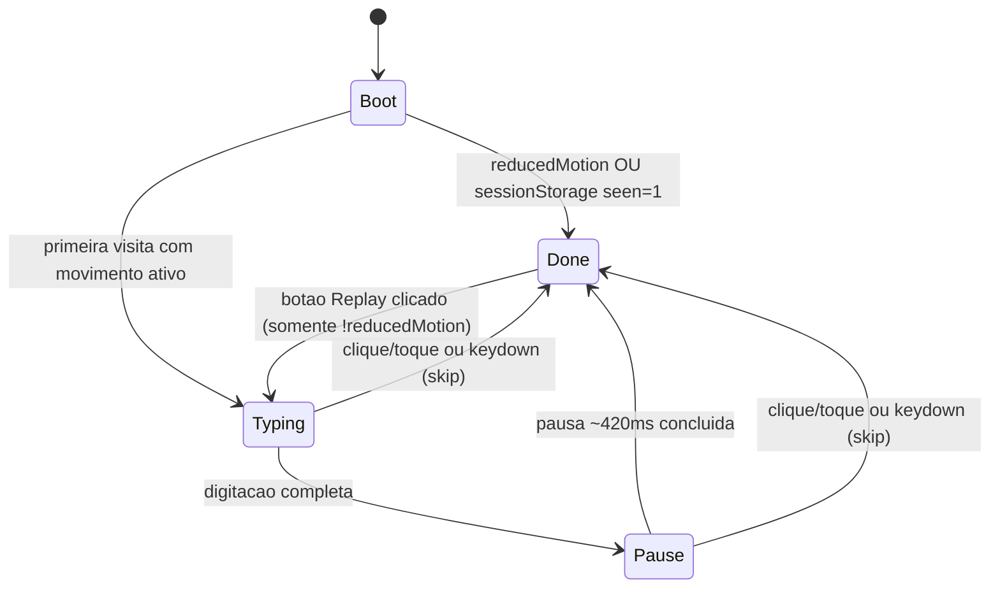

# Documento de Design — Portfolio MVP

## Visão Geral (Overview)

O MVP do portfólio de **Breno Porto** será construído como uma **Single-Page Application (SPA) estática** usando **Vite + React 19 + TypeScript (strict) + Tailwind CSS v4 + Motion (`motion/react`)**, sem dependências de backend, com fonte **JetBrains Mono self-hosted** (`@fontsource-variable/jetbrains-mono`) e ícones lineares leves (`lucide-react`).

O design une três pilares:
1. **Estética de terminal moderno no macOS (Ghostty/Kitty):** hero minimalista `"hello!, i'm breno!"` acima de uma janela de terminal centralizada com borda `1px`, *titlebar* com 3 controles decorativos monocromáticos Base2Tone (`~/breno-porto`, replay, `EN | PT`), barra de abas numeradas (`01`, `02`, `03`) e *status bar* estilo tmux/Yazi.
2. **Animações fluidas estilo macOS (spring physics):** sequência de abertura com digitação + transição *shared layout* (`layoutId="hero-greeting"`, `layout="position"`), indicador deslizante de abas (`layoutId="active-tab-indicator"`) e acordeão inline com mola para projetos — integralmente subordinadas a `prefers-reduced-motion`.
3. **Arquitetura orientada a dados e tokens:** conteúdo isolado em `src/data/`, traduções isoladas em `src/i18n/` e paleta **Base2Tone Space Dark** integralmente expressa em CSS custom properties semânticas (`src/styles/tokens.css`), viabilizando novos projetos ou novas variantes Base2Tone na v2 sem refatorar componentes.

---

## Arquitetura (Architecture)

### Estrutura de Diretórios

```text
portfolio/
├── index.html                        # Metadados SEO/OG, favicon Base2Tone SVG, root
├── vite.config.ts                    # Vite + React + @tailwindcss/vite + base portável ('./')
├── vitest.config.ts                  # Vitest + jsdom + setup de testes
├── tsconfig.json                     # TypeScript strict
├── public/
│   └── favicon.svg                   # Favicon minimalista coerente com Base2Tone Space Dark
└── src/
    ├── main.tsx                      # Entry point + import @fontsource-variable/jetbrains-mono
    ├── App.tsx                       # Orquestração MotionConfig, I18nProvider, LayoutGroup, intro & shell
    ├── styles/
    │   ├── tokens.css                # Paleta Base2Tone Space Dark em CSS custom properties
    │   └── index.css                 # @import "tailwindcss", @theme inline, focus-visible, base
    ├── data/
    │   ├── types.ts                  # Contratos TypeScript (Locale, TabId, Project, ProfileData, etc.)
    │   ├── profile.ts                # Fonte da verdade (identidade, formação UNIFESP, bio, links)
    │   ├── pillars.ts                # 4 pilares técnicos + certificação Six Sigma Green Belt
    │   └── projects.ts               # Array tipado de projetos (burnout-study + mp3-tui)
    ├── i18n/
    │   ├── dictionaries.ts           # Dicionários de UI EN e PT-BR (abas, status, contato, ARIA)
    │   └── I18nContext.tsx           # Provider + hook useI18n (localStorage + document lang/title)
    ├── utils/
    │   ├── storage.ts                # Wrappers seguros try/catch para localStorage e sessionStorage
    │   └── tabHash.ts                # parseTabHash() e atualização segura de URL hash
    ├── hooks/
    │   ├── useReducedMotion.ts       # matchMedia('(prefers-reduced-motion: reduce)') reativo
    │   ├── useIntroSequence.ts       # Máquina de estados typing -> pause -> done + skip/replay
    │   ├── useTabNavigation.ts       # Estado da aba, hash sync, atalhos 1-3 / setas / Home / End
    │   └── useClipboard.ts           # Clipboard API + fallback execCommand + timer limpo
    ├── components/
    │   ├── IntroOverlay.tsx          # Tela limpa de abertura com digitação e cursor piscando
    │   ├── HeroHeader.tsx            # Hero "hello!, i'm breno!" acima da janela (layoutId)
    │   ├── TerminalWindow.tsx        # Moldura Ghostty/macOS integrando TitleBar, TabBar, painel e StatusBar
    │   ├── TitleBar.tsx              # Controles monocromáticos, ~/breno-porto, replay e switch EN | PT
    │   ├── TabBar.tsx                # WAI-ARIA tablist + indicador spring deslizante
    │   ├── StatusBar.tsx             # Rodapé tmux/Yazi (UNIFESP · CS '28, disponibilidade, [1-3])
    │   ├── AboutTab.tsx              # Bio, graduação, objetivo de estágio e 4 pilares + Six Sigma
    │   ├── ProjectsTab.tsx           # Listagem orientada a dados + estado vazio defensivo
    │   ├── ProjectAccordionItem.tsx  # Card expansível em acordeão inline com mola
    │   └── ContactTab.tsx            # E-mail (copiar 1 clique + mailto), GitHub, LinkedIn e nota
    └── test/
        ├── setup.ts                  # @testing-library/jest-dom + helper mockMatchMedia
        ├── tabHash.test.ts           # Unitários de parseTabHash e storage seguro
        ├── dataIntegrity.test.ts     # Integridade de profile/projects/i18n (sem idade fixa)
        ├── TabNavigation.test.tsx    # Clique, atalhos 1-3/setas, WAI-ARIA e URL hash
        ├── I18n.test.tsx             # Default EN, switch EN|PT, localStorage e lang/title
        ├── ProjectsTab.test.tsx      # 2 projetos reais, acordeão, links e estado vazio
        ├── ContactTab.test.tsx       # Cópia, aria-live, timer, fallback e erro
        └── IntroSequence.test.tsx    # Digitação, skip, sessionStorage, replay e reduced-motion
```

### Fluxo de Componentes e Estado



### Máquina de Estados da Intro (`useIntroSequence`)



---

## Sistema Visual, Paleta Base2Tone e Motion

### Tokens Semânticos (`src/styles/tokens.css`)

Toda a paleta **Base2Tone Space Dark** é definida como CSS custom properties em `:root, [data-theme="base2tone-space-dark"]` e ligada ao Tailwind CSS v4 via `@theme inline`:

| Token Semântico | Valor Base2Tone Space Dark | Uso Principal |
|---|---|---|
| `--bg` | `#24242e` | Fundo da página e base interna da janela |
| `--surface` | `#333342` | *Titlebar*, *status bar* e superfícies elevadas |
| `--surface-subtle` | `color-mix(in srgb, var(--surface) 55%, var(--bg))` | Fundo de cards e estado hover sutil (auto-derivado por tema) |
| `--border` | `#515167` | Borda `1px` da janela, divisores e cards |
| `--border-strong` | `#5b5b76` | Borda em hover/foco e controles monocromáticos da *titlebar* |
| `--text-primary` | `#ebebff` | Títulos, corpo principal, itens ativos (contraste ~13.7:1 em `--bg`) |
| `--text-secondary` | `#cecee3` | Parágrafos de leitura e descrições (contraste ~10.6:1 em `--bg`) |
| `--text-muted` | `#a1a1b5` | Metadados, abas inativas, labels em `--surface` (contraste >= 5.2:1) |
| `--text-subtle` | `#8a8aa3` | Pontuação/prefixos decorativos apenas sobre `--bg` (contraste ~4.85:1) |
| `--accent-primary` | `#7676f4` | Indicador ativo de abas, links/destaques interativos |
| `--accent-primary-strong` | `#6363ee` | Anel de foco (`:focus-visible`) e destaque de foco |
| `--accent-highlight` | `#fe8c52` | Cursor de terminal, índices ativos (`01`), dot de disponibilidade, `"copied!"` |
| `--accent-highlight-strong` | `#ec7336` | Hover/ênfase de elementos em coral-âmbar |

**Decisão de Contraste (WCAG AA):** `#8a8aa3` (`--text-subtle`) atinge ~4.85:1 sobre `--bg` (`#24242e`), mas ~3.9:1 sobre `--surface` (`#333342`). Portanto, textos informativos sobre `--surface` (*titlebar*, *status bar*, headers de cards) utilizarão sempre `--text-muted` (`#a1a1b5`, ~5.2:1) ou mais claro, garantindo WCAG AA >= 4.5:1 em toda a interface.

### Especificação de Animações (Motion / Spring Physics)

| Interação | Mecanismo Motion | Parâmetros | Comportamento em `prefers-reduced-motion: reduce` |
|---|---|---|---|
| **Intro: digitação** | Timer controlado em `useIntroSequence` (~52ms/char) + cursor com blink CSS | `"hello!, i'm breno!"` (18 chars ≈ 0,94s) + pausa 420ms | Pulo automático na carga; sem digitação/movimento |
| **Intro -> Hero** | `<motion.div layoutId="hero-greeting" layout="position">` | `type: "spring", stiffness: 260, damping: 28, mass: 0.9` | Renderização imediata no estado final |
| **Entrada da Janela** | `<motion.main>` fade + scale (`opacity: 0->1, scale: 0.97->1, y: 12->0`) | `type: "spring", stiffness: 240, damping: 26, delay: 0.08` | Renderização imediata sem escala/translação |
| **Indicador de Aba** | `<motion.span layoutId="active-tab-indicator">` | `type: "spring", stiffness: 420, damping: 34, mass: 0.8` | Troca instantânea (`duration: 0`) |
| **Troca de Painel** | `<AnimatePresence mode="wait">` (`opacity: 0->1, y: 6->0`) | `duration: 0.16, ease: "easeOut"` | Troca instantânea sem deslocamento `y` |
| **Acordeão de Projeto** | `<AnimatePresence initial={false}>` (`height: 0->"auto", opacity: 0->1`) | `type: "spring", stiffness: 320, damping: 32` | Abertura/fechamento instantâneo |
| **Micro-interações** | Hover de borda/cor + troca de ícone/texto no botão copiar (`copied!`) | Transições CSS de 150ms + spring leve no ícone | Sem transformações espaciais |

**Decisão Técnica (`layout="position"` no Hero):** usar `layout="position"` (em vez de `layout={true}`) e manter o mesmo tamanho tipográfico (`text-2xl sm:text-3xl`) entre `IntroOverlay` e `HeroHeader` impede a distorção de escala/borramento de texto característica do FLIP quando um elemento muda de largura/altura simultaneamente.

---

## Componentes e Interfaces (Components and Interfaces)

### 1. `IntroOverlay`
- **Responsabilidade:** exibir tela limpa centralizada durante `phase === 'typing' | 'pause'`, digitando progressivamente `"hello!, i'm breno!"` com cursor em `--accent-highlight` e uma dica ultra-discreta localizada no rodapé (`click or press any key to skip` / `clique ou pressione qualquer tecla para pular`).
- **Props:** `{ typedText: string; onSkip: () => void }`
- **Acessibilidade:** exibe texto completo para leitores de tela via `aria-label="hello!, i'm breno!"` sem anunciar cada caractere individualmente; clique em qualquer área dispara `onSkip`.

### 2. `HeroHeader`
- **Responsabilidade:** renderizar o título principal `"hello!, i'm breno!"` acima da janela do terminal compartilhando `layoutId="hero-greeting"` (`layout="position"`), acompanhado de cursor de terminal sutil em `--accent-highlight`.
- **Props:** `{ greeting: string; reducedMotion: boolean }`

### 3. `TerminalWindow`
- **Responsabilidade:** moldura centralizada estilo Ghostty/macOS (`max-w-[820px] w-full rounded-xl border border-[var(--border)]`), compondo `TitleBar`, `TabBar`, o painel ativo (`role="tabpanel"`) e `StatusBar`.
- **Props:**
  ```ts
  interface TerminalWindowProps {
    activeTab: TabId;
    onSelectTab: (tab: TabId) => void;
    onReplayIntro: () => void;
    reducedMotion: boolean;
  }
  ```

### 4. `TitleBar`
- **Responsabilidade:** barra superior estilo macOS com:
  - Esquerda: 3 bolinhas decorativas monocromáticas (`11px`, `aria-hidden="true"`) usando `--border-strong` / `--border` com leve graduação de opacidade.
  - Centro/Esquerda: título `~/breno-porto` (`text-xs text-[var(--text-muted)]`).
  - Direita: botão discreto de replay (`RotateCcw`, oculto quando `reducedMotion === true`, com `aria-label` traduzido) + switch `EN | PT` (`role="group"`, botões com `aria-pressed`).
- **Props:** `{ pathLabel: string; showReplay: boolean; onReplay: () => void }`

### 5. `TabBar`
- **Responsabilidade:** barra de navegação horizontal com as 3 abas (`01 about`, `02 projects`, `03 contact` / traduções PT-BR), implementando integralmente WAI-ARIA Tabs (`role="tablist"`, `role="tab"`, `aria-selected`, `aria-controls`, roving `tabIndex`, `id="tab-{id}"`) e foco programático via `refs` ao navegar por teclado (`ArrowLeft`, `ArrowRight`, `Home`, `End`).
- **Props:**
  ```ts
  interface TabBarProps {
    activeTab: TabId;
    onSelectTab: (tab: TabId) => void;
    reducedMotion: boolean;
  }
  ```

### 6. `AboutTab`
- **Responsabilidade:** apresentar a fonte da verdade de Breno Porto de forma limpa e escaneável:
  - Cabeçalho conciso (`Breno Porto`, `UNIFESP`, previsão `Dez/2028` / `Dec/2028`) + linha de objetivo de estágio com prefixo `>` em `--accent-highlight`.
  - Bio em 2 parágrafos diretos (traduzidos naturalmente entre EN e PT-BR).
  - Grid responsivo (`grid-cols-1 sm:grid-cols-2`) com os **4 pilares técnicos** estilizados como blocos estruturados de terminal (`01`–`04`, título, resumo conciso e termos-chave separados por `·`, sem excesso de badges coloridos).
  - Destaque limpo da certificação **Six Sigma Green Belt** integrada ao pilar 04 e/ou linha dedicada de credencial.

### 7. `ProjectsTab` & `ProjectAccordionItem`
- **Responsabilidade:**
  - `ProjectsTab` consome o array `projects` (aceitando prop opcional `projects?: readonly Project[]` com default para `PROJECTS` de `src/data/projects.ts` — facilita testes do estado vazio!). Controla qual(is) acordeão(ões) estão abertos (permite expandir/recolher cada projeto de forma independente ou um por vez; usar um `Set<string>` ou `expandedIds` permite comparar os dois projetos lado a lado sem fechar o outro, padrão excelente para recrutadores!).
  - `ProjectAccordionItem` renderiza um cabeçalho `<button type="button" aria-expanded={isExpanded} aria-controls={panelId} id={headerId}>` com nome do repo, categoria/ano, resumo, stack principal resumida e chevron animado. Ao expandir, abre região `id={panelId} role="region" aria-labelledby={headerId}` com animação spring contendo destaques técnicos detalhados, stack completa e links (`GitHub ↗` + `demoUrl` apenas quando definido).

### 8. `ContactTab`
- **Responsabilidade:** exibir nota de disponibilidade para estágio + os 3 canais oficiais em layout tabular limpo estilo terminal:
  - **Email (`brenoppprado@gmail.com`):** link `mailto:brenoppprado@gmail.com` (texto selecionável) + botão de copiar com 1 clique via `useClipboard` exibindo `copy` / `copied!` / `copy failed` (e equivalentes PT-BR) + região acessível `<span role="status" aria-live="polite" className="sr-only">`.
  - **GitHub:** link externo `https://github.com/brenoprato` (`target="_blank" rel="noopener noreferrer"`).
  - **LinkedIn:** link externo `https://www.linkedin.com/in/breno-porto/` (`target="_blank" rel="noopener noreferrer"`).

### 9. `StatusBar`
- **Responsabilidade:** barra inferior discreta estilo tmux/Yazi exibindo `UNIFESP · CS '28`, indicador sutil (ponto em `--accent-highlight`) + `open to internships` / `disponível para estágio`, e dica `[1-3]` (oculta em telas `< 420px` via `hidden sm:inline` para manter respiro em `320px`).

---

## Modelos de Dados (Data Models)

Definidos em `src/data/types.ts`:

```ts
export type Locale = 'en' | 'pt-BR';
export type TabId = 'about' | 'projects' | 'contact';
export type IntroPhase = 'typing' | 'pause' | 'done';
export type CopyStatus = 'idle' | 'copied' | 'error';
export type ProjectStatus = 'completed' | 'active' | 'archived';

export type LocalizedText = Readonly<Record<Locale, string>>;
export type LocalizedList = Readonly<Record<Locale, readonly string[]>>;

export interface TechnicalPillar {
  readonly id: string;
  readonly index: string;
  readonly title: LocalizedText;
  readonly summary: LocalizedText;
  readonly stackLine: string;
}

export interface Project {
  readonly id: string;
  readonly name: string;
  readonly category: LocalizedText;
  readonly year: string;
  readonly status: ProjectStatus;
  readonly summary: LocalizedText;
  readonly highlights: LocalizedList;
  readonly stack: readonly string[];
  readonly repoUrl: string;
  readonly demoUrl?: string;
}

export interface ProfileData {
  readonly name: string;
  readonly greetingSignature: string;
  readonly terminalPath: string;
  readonly education: {
    readonly institution: string;
    readonly degree: LocalizedText;
    readonly expectedGraduation: LocalizedText;
    readonly shortBadge: string;
  };
  readonly certification: {
    readonly name: string;
    readonly description: LocalizedText;
  };
  readonly bio: LocalizedList;
  readonly internshipGoal: LocalizedText;
  readonly contact: {
    readonly email: string;
    readonly githubUrl: string;
    readonly githubDisplay: string;
    readonly linkedinUrl: string;
    readonly linkedinDisplay: string;
  };
}
```

### Dados dos Projetos Iniciais (`src/data/projects.ts`)
1. **`supervised-learning-burnout-study`**:
   - Repositório: `https://github.com/brenoprato/supervised-learning-burnout-study`
   - Categoria: `Machine Learning & Data Science` / `Machine Learning & Ciência de Dados` · Ano: `2026` · Status: `completed`
   - Stack: `['Python', 'Pandas', 'Scikit-learn', 'XGBoost', 'Linear Regression', 'Random Forest']`
   - Destaques técnicos precisos (do repositório):
     - Pipeline modular em 5 etapas (`eda`, `preprocessing`, `training`, `evaluation`, `scoring`) sobre o *Remote Work Health Impact Survey 2025* (3.157 registros em regimes remoto, híbrido e presencial).
     - Benchmark comparativo entre Regressão Linear (baseline: MAE 0,635, RMSE 0,764), Random Forest (MAE 0,665) e XGBoost (MAE 0,640; K-Fold k=5 MAE 0,596 ± 0,009).
     - Análise de importância de features (`Work_Arrangement`, `Age`, `Hours_Per_Week`), equidade por gênero/regime alinhada aos ODS 3, 8 e 10 da ONU e função de scoring contínuo `predict_burnout()` (0–1 + faixa de risco).
2. **`mp3-tui`**:
   - Repositório: `https://github.com/brenoprato/mp3-tui`
   - Categoria: `Systems & Terminal UI` / `Sistemas & Terminal UI` · Ano: `2026` · Status: `active`
   - Stack: `['Rust', 'Ratatui', 'Rodio', 'rustfft', 'Lofty', 'Walkdir', 'Crossterm']`
   - Destaques técnicos precisos (do repositório):
     - Interface TUI inspirada no Yazi com biblioteca local orientada a fontes (diretórios), busca instantânea multi-token e controles completos de fila, shuffle, repeat, seek (±5s) e volume.
     - Visualizador de espectro FFT em tempo real baseado em ring buffer PCM atômico lock-free (`SampleRingBuffer`) + `rustfft` com janela de Hann, bandas logarítmicas e blocos Unicode (`▁▂▃▄▅▆▇█`).
     - Persistência XDG segura com escrita atômica em TOML, cache JSON de duração invalidado por `(file_size, mtime)`, tema ANSI adaptativo e suporte multiplataforma (Linux, macOS e Windows).

---

## Tratamento de Erros e Casos de Borda (Error Handling)

| Cenário | Estratégia de Mitigação |
|---|---|
| `localStorage` ou `sessionStorage` indisponível/bloqueado (`SecurityError` / `QuotaExceededError`) | Todas as leituras/escritas passam por `src/utils/storage.ts` encapsulado em `try/catch`; falhas retornam `null` e degradam silenciosamente para estado em memória (`en` como locale padrão, intro executa uma vez na memória). |
| Valor corrompido em `localStorage` para locale (ex.: `"fr"`) | Validação estrita contra `['en', 'pt-BR']`; valores inválidos caem silenciosamente em `'en'`. |
| URL hash ausente ou inválido (`#foo`, `#`, `#ABOUT`) | `parseTabHash()` normaliza lowercase e aceita apenas `about | projects | contact`; qualquer outro valor retorna `'about'` sem erro. |
| Teclas pressionadas durante a intro (ex.: usuário aperta `2` para pular) | `useIntroSequence` consome o evento de skip; `useTabNavigation` só registra atalhos globais quando `isIntroActive === false`, impedindo troca acidental de aba no mesmo keypress. |
| Atalhos de teclado com modificadores (`Cmd+1`, `Ctrl+2`, `Alt+ArrowLeft`) ou em campos editáveis | Guard explícito no handler global (`e.ctrlKey || e.metaKey || e.altKey` ou target editável) ignora o atalho para não sequestrar navegação do navegador. |
| `navigator.clipboard.writeText` falha ou não existe (contexto não-HTTPS / permissão negada) | `useClipboard` tenta fallback síncrono via `<textarea>` off-screen + `document.execCommand('copy')` com limpeza em `finally`. Se falhar, define status `'error'` (`copy failed` / `erro ao copiar`), mantendo o e-mail selecionável e o link `mailto:` funcional. |
| Cliques rápidos no botão de copiar ou unmount antes do reset (~2s) | `timeoutRef` limpo antes de cada novo agendamento e no cleanup do `useEffect`, evitando race conditions e vazamento de memória. |
| `window.matchMedia` ausente em ambiente minimalista / teste | `useReducedMotion` verifica `typeof window.matchMedia === 'function'` e faz fallback seguro para `false`. |
| `projects` vazio ou `demoUrl` indefinido | `ProjectsTab` exibe estado vazio limpo localizado; `ProjectAccordionItem` renderiza link de demo apenas quando `Boolean(project.demoUrl)`. |
| Deploy em raiz (`/`) vs subpath (`/portfolio/`) | `vite.config.ts` usa `base: process.env.VITE_BASE_PATH ?? './'` para que assets (JS, CSS, fonte JetBrains Mono e favicon) resolvam corretamente em qualquer provedor estático. |

---

## Decisões Arquiteturais e Justificativas

1. **Tailwind CSS v4 (`@tailwindcss/vite`) + CSS Custom Properties (`tokens.css`):** elimina `tailwind.config.js` legado, mantém build rápido e permite trocar toda a paleta Base2Tone no futuro apenas adicionando outro bloco `[data-theme="..."]` em `tokens.css`.
2. **Sem biblioteca pesada de i18n (`i18next`):** o portfólio possui 2 idiomas fixos (`en`, `pt-BR`) e conteúdo estático conhecido em tempo de compilação. Um `I18nContext` tipado com TypeScript oferece autocompletar estrito, zero overhead de bundle e garantia em tempo de compilação de que nenhuma chave fique sem tradução.
3. **Sem roteador (`react-router`):** navegação em 3 abas sincronizadas via URL hash (`#about`, `#projects`, `#contact`) com `parseTabHash` + `hashchange` + `history.replaceState` oferece deep-linking compartilhável com zero dependência externa e compatibilidade universal em hosts estáticos (sem precisar de rewrite rules de servidor).
4. **Acordeão multi-expansível (estado `expandedIds: Set<string>`):** permite que um recrutador abra ambos os projetos para compará-los ou abra/feche um de cada vez sem movimentos bruscos de rolagem.
5. **JetBrains Mono via `@fontsource-variable/jetbrains-mono`:** fonte empacotada no próprio bundle estático, evitando dependência externa de Google Fonts, garantindo carregamento rápido e estética consistente em qualquer rede.

---

## Estratégia de Testes (Testing Strategy)

### Ferramentas
- **Vitest** + ambiente **jsdom**
- **@testing-library/react** + **@testing-library/user-event** + **@testing-library/jest-dom**
- Helper `mockMatchMedia(reduced: boolean)` em `src/test/setup.ts` para alternar `prefers-reduced-motion` de forma determinística por caso de teste.

### Cobertura Planejada

1. **Testes Unitários (`tabHash.test.ts`, `dataIntegrity.test.ts`):**
   - `parseTabHash`: `#about`, `#projects`, `#contact`, `#PROJECTS`, vazio `""`, inválido `#unknown`.
   - `storage.ts`: operações normais e recuperação sem exceção quando `getItem`/`setItem` lançam erro.
   - Integridade dos dados: presença de EN e PT-BR em todos os campos localizados, URLs oficiais corretas, ausência de idade fixa no perfil e nos dicionários.
2. **Testes de Componentes e Integração:**
   - **`TabNavigation.test.tsx`:** clique nas 3 abas, verificação completa de WAI-ARIA (`tablist`, `tab`, `aria-selected`, `aria-controls`, `tabpanel`, `aria-labelledby`), atalhos `1`/`2`/`3` (ignorando `Ctrl+1`), `ArrowLeft`/`ArrowRight`/`Home`/`End`, inicialização via `#projects`, fallback via `#invalid` e resposta a `hashchange`.
   - **`I18n.test.tsx`:** inicialização padrão em `en`, troca para `pt-BR` via switch `EN | PT`, verificação da tradução de abas/status/seções/labels ARIA, assinatura fixa `"hello!, i'm breno!"`, atualização de `document.documentElement.lang` e `document.title`, persistência em `localStorage` e fallback com valor inválido ou storage bloqueado.
   - **`ProjectsTab.test.tsx`:** renderização de `supervised-learning-burnout-study` e `mp3-tui`, expansão/recolhimento por clique e teclado (`Enter`/`Space`), atualização de `aria-expanded`, link externo com `target="_blank" rel="noopener noreferrer"`, omissão de link de demo quando ausente e renderização limpa de estado vazio (`projects={[]}`).
   - **`ContactTab.test.tsx`:** cópia de `brenoppprado@gmail.com` via `navigator.clipboard.writeText`, feedback `copied!` / `copiado!` + anúncio em `role="status"` (`aria-live="polite"`), reversão automática após 2s com `vi.useFakeTimers()`, cliques repetidos sem timer órfão, fallback via `execCommand` quando Clipboard API falha, e feedback `copy failed` / `erro ao copiar` quando ambos falham mantendo `mailto:` ativo.
   - **`IntroSequence.test.tsx`:** renderização da digitação inicial na 1ª visita, gravação em `sessionStorage` após conclusão/skip, skip imediato ao clicar ou pressionar tecla, salto automático quando `sessionStorage` já registra conclusão, salto automático + ocultação do botão de replay quando `prefers-reduced-motion: reduce`, e reexecução pelo botão de replay preservando a aba ativa.
3. **Verificação de Qualidade e Build:**
   - `npx tsc --noEmit` (zero erros em modo strict)
   - `npm test` (Vitest em modo single-run, 100% verde)
   - `npm run build` (build Vite estático validado sem erros)

---

## Rastreabilidade Requisitos → Design

| Requisito | Módulos / Componentes | Validação |
|---|---|---|
| **Req 1 (Identidade e Conteúdo)** | `src/data/profile.ts`, `src/data/pillars.ts`, `AboutTab`, `ContactTab` | `dataIntegrity.test.ts`, `I18n.test.tsx` |
| **Req 2 (Intro & Movimento)** | `useReducedMotion`, `useIntroSequence`, `IntroOverlay`, `HeroHeader`, `TitleBar` | `IntroSequence.test.tsx` |
| **Req 3 (Terminal + Base2Tone)** | `tokens.css`, `index.css`, `TerminalWindow`, `TitleBar`, `StatusBar` | Build CSS + testes de render/ARIA |
| **Req 4 (Abas, Teclado, Hash, ARIA)** | `tabHash.ts`, `useTabNavigation`, `TabBar`, `TerminalWindow` | `tabHash.test.ts`, `TabNavigation.test.tsx` |
| **Req 5 (i18n EN / PT-BR)** | `dictionaries.ts`, `I18nContext.tsx`, `storage.ts`, `TitleBar` | `I18n.test.tsx` |
| **Req 6 (Aba `about`)** | `profile.ts`, `pillars.ts`, `AboutTab` | `dataIntegrity.test.ts`, `I18n.test.tsx` |
| **Req 7 (Aba `projects` + Acordeão)** | `projects.ts`, `ProjectsTab`, `ProjectAccordionItem` | `ProjectsTab.test.tsx` |
| **Req 8 (Aba `contact` + Clipboard)** | `useClipboard`, `ContactTab` | `ContactTab.test.tsx` |
| **Req 9 (Qualidade, Build e Testes)** | `vite.config.ts`, `vitest.config.ts`, `tsconfig.json`, `src/test/*` | `tsc --noEmit`, `npm test`, `npm run build` |
